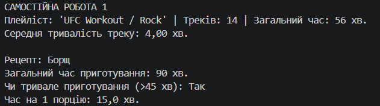

# Звіт до самостійної роботи №1
**Тема:** Базовий синтаксис C# і оголошення класів

## 1. Створені класи
* **`Playlist`:** Містить назву, кількість композицій і їхню загальну тривалість. Метод `GetAverageTrackLength()` знаходить середню тривалість треку, а `PrintInfo()` показує дані плейліста. За відсутності треків результатом є `0`.
* **`Recipe`:** Описує назву рецепта, тривалість приготування та кількість порцій. Метод `IsLongToCook()` визначає, чи перевищує час приготування 45 хвилин, а `GetTimePerServing()` розраховує час для однієї порції.

## 2. Інкапсуляція та приклад використання
* Внутрішній стан обох класів зберігається у приватних полях і задається конструкторами.
* У `Playlist` властивість `Title` можна читати й змінювати, а `TrackCount` доступна лише для читання.
* У `Recipe` властивість `Name` доступна лише для читання, а сеттер `CookingTimeMinutes` приватний.
* У `Main` створюються об'єкти плейліста й рецепта, після чого викликаються їхні методи та виводяться результати.

## 3. Відповіді на контрольні запитання
1. **Які мінімальні елементи повинен містити клас у цьому завданні?**
   Клас має містити приватні поля, відкриту властивість, конструктор і метод, який реалізує потрібну логіку.
2. **Чому поля доцільно робити приватними, а доступ надавати через властивості?**
   Так внутрішній стан об'єкта залишається захищеним, а властивості регулюють доступ до читання та зміни даних.
3. **Для чого потрібен конструктор?**
   Конструктор використовується для формування початкових значень об'єкта під час його створення.
4. **Як у `Main` показати, що методи класу працюють коректно?**
   Потрібно створити об'єкти з наперед відомими значеннями, викликати їхні методи та показати отримані результати.
