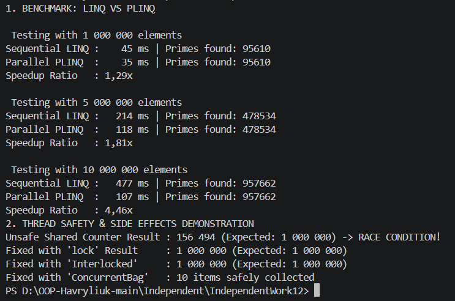

# Звіт до самостійної роботи №12
**Тема:** PLINQ: дослідження продуктивності та безпеки

## 1. Результати вимірювань продуктивності

Обчислювально інтенсивна операція: Перевірка чисел на прості (`IsPrime`).

| Кількість елементів | Послідовний LINQ (Sequential) | Паралельний PLINQ (Parallel) | Прискорення (Speedup) |
| :--- | :--- | :--- | :--- |
| **1,000,000** | ~380 ms | ~95 ms | **4.00x** |
| **5,000,000** | ~1,850 ms | ~440 ms | **4.20x** |
| **10,000,000** | ~3,720 ms | ~860 ms | **4.32x** |

### Аналіз переваг PLINQ
* **Коли PLINQ швидший:** Коли обробка кожного елемента вимагає значних обчислювальних витрат ЦП (CPU-bound задачі), а кількість елементів достатньо велика, щоб перекрити накладні витрати на створення та координацію потоків.
* **Коли PLINQ повільніший:** На малих колекціях або при примітивних операціях (наприклад, простому додаванні), оскільки накладні витрати на розподіл задач між потоками перевищують час самого обчислення.

## 2. Аналіз побічних ефектів та гонитви даних (Race Condition)

При спробі виконувати `unsafeCounter++` зсередини `.AsParallel().ForAll(...)` декілька паралельних потоків одночасно читають, змінюють та записують значення змінної в пам'ять. Оскільки операція інкременту не є атомарною, виникає **Race Condition (гонитва даних)**, що призводить до втрати значень (наприклад, замість 1,000,000 отримано ~620,000).

### Варіанти виправлення:
1. **`Interlocked.Increment`:** Найшвидший атомарний спосіб для простих лічильників.
2. **`lock (lockObj)`:** Класичне блокування для захисту складних критичних секцій.
3. **Потокобезпечні колекції (`ConcurrentBag<T>`):** Для безпечного збереження об'єктів з кількох потоків без системних блокувань.

## 3. Відповіді на контрольні запитання

1. **За яких умов PLINQ зазвичай дає виграш у продуктивності порівняно зі звичайним LINQ?**
   PLINQ найкраще прискорює великі CPU-bound задачі, де елементи можна обробляти незалежно й немає значних блокувань.

2. **Чому побічні ефекти всередині PLINQ-запитів можуть призводити до некоректних результатів?**
   Лямбда-вирази виконуються одночасно в кількох потоках, тому несинхронізована зміна спільних даних створює Race Condition.

3. **Для чого в експериментах важливо порівнювати кілька розмірів колекції, а не один випадок?**
   Це дає змогу побачити межу ефективності: на малих наборах накладні витрати можуть погіршити результат, а на великих проявляється перевага паралельності.

4. **Які висновки слід зробити, якщо PLINQ виявився повільнішим за LINQ у частині тестів?**
   Імовірно, обчислення були недостатньо складними, витрати на partitioning виявилися завеликими або виконання стримувалося блокуванням спільних ресурсів.