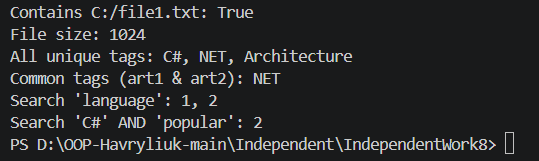

# Звіт до самостійної роботи №8
**Тема:** Дослідження Dictionary<TKey, TValue> та HashSet<T> у .NET

## 1. Використання в Open-Source проєктах

1. **Newtonsoft.Json (`Dictionary<string, JsonProperty>`)**
   * **Контекст:** Кешування метаданих рефлексії типів під час серіалізації/десеріалізації.
   * **Причина вибору:** Швидкий доступ за ім'ям властивості O(1).
   * **Складність:** O(1) для пошуку.

2. **Entity Framework Core (`HashSet<IEntityType>`)**
   * **Контекст:** Збереження відвіданих типів сутностей під час побудови метамоделі бази даних.
   * **Причина вибору:** Гарантія відсутності дублікатів та перевірка наявності сутності за O(1).
   * **Складність:** O(1) додавання та перевірка.

3. **Dapper (`Dictionary<Type, CacheInfo>` + `HashSet<string>`)**
   * **Контекст:** Комбінований кеш згенерованого SQL та списку параметрів.
   * **Причина вибору:** Асоціативний зв'язок тип->план запиту та швидка перевірка унікальності імен параметрів.

## 2. Порівняльна таблиця складності операцій

| Операція | List<T> | Dictionary<TKey, TValue> | HashSet<T> | Коли використовувати |
| :--- | :--- | :--- | :--- | :--- |
| **Додавання** | O(1) | O(1) | O(1) | List — для впорядкованих даних; Dictionary/HashSet — для швидкої ідентифікації |
| **Пошук за значенням** | O(n) | N/A | O(1) | HashSet — якщо потрібна лише швидка перевірка наявності елемента |
| **Пошук за ключем** | N/A | O(1) | N/A | Dictionary — якщо є парування "Ключ -> Значення" |
| **Видалення** | O(n) | O(1) | O(1) | Dictionary/HashSet при частих видаленнях за ключем/значенням |
| **Перевірка наявності** | O(n) | O(1) | O(1) | Dictionary/HashSet уникають лінійного перебору |

## 3. Відповіді на контрольні запитання

1. **Які переваги узагальнених колекцій над неузагальненими структурами даних у .NET?**
   Узагальнені колекції перевіряють типи ще під час компіляції та не створюють зайвих витрат на boxing/unboxing.

2. **У яких сценаріях доцільніше використовувати Dictionary<TKey, TValue>, а в яких HashSet<T>?**
   `Dictionary` підходить для зв'язку ключа з відповідним значенням, наприклад ID -> об'єкт. `HashSet` варто обрати, коли важливі унікальність і операції над множинами.

3. **Як IEqualityComparer<T> впливає на коректність і продуктивність Dictionary та HashSet?**
   Цей інтерфейс задає правила обчислення `GetHashCode` і перевірки `Equals`. Добре підібраний компаратор підтримує коректність і зменшує кількість колізій, зберігаючи швидкий доступ.

4. **Чому інвертований індекс зручно будувати саме на базі Dictionary<string, HashSet<int>>?**
   `Dictionary` швидко пов'язує слово з набором документів, а `HashSet` не допускає повторів ID і підтримує ефективні AND/OR операції через `IntersectWith` та `UnionWith`.