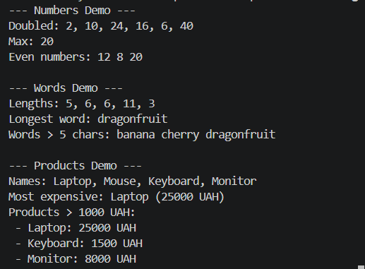

# Звіт до самостійної роботи №9
**Тема:** Делегати й лямбда-вирази: власні утиліти для колекцій

## 1. Огляд утиліт і порівняння з LINQ

 Власний метод | Аналог в LINQ | Призначення |
 :--- | :--- | :--- |
 `Map<TSource, TResult>` | `.Select()` | Перетворення кожного елемента колекції 
 `MaxBy<T, TKey>` | `.MaxBy()` | Знаходження об'єкта з максимальним значенням ключа 
 `Filter<T>` | `.Where()` | Фільтрація елементів за умовою 
 `ForEach<T>` | `.ToList().ForEach()` | Виконання дії над кожним елементом 

## 2. Відповіді на контрольні запитання

1. **Чому делегати є зручним механізмом для передавання поведінки в узагальнені методи?**
   Делегат передає функцію як параметр, тому алгоритм обходу колекції можна відокремити від правил обробки її елементів.

2. **У чому різниця між Func<T, TResult>, Action<T> та Predicate<T>?**
   * `Func<T, TResult>` отримує `T` і повертає результат типу `TResult`.
   * `Action<T>` отримує `T`, виконує дію та не повертає значення.
   * `Predicate<T>` отримує `T` і повертає `bool` для перевірки умови.

3. **Які переваги дає поєднання делегат-методів і лямбда-виразів під час роботи з колекціями?**
   Воно робить код коротшим і зрозумілішим, дозволяючи описувати одноразові операції без додаткових іменованих методів чи анонімних класів.

4. **У яких випадках власні утиліти на кшталт Map чи Filter корисно реалізувати самостійно, навіть якщо існує LINQ?**
   * У навантажених системах це може зменшити кількість алокацій, пов'язаних із LINQ та ітераторами.
   * У середовищах на кшталт GameDev або Unity власна реалізація допомагає уникнути зайвої роботи Garbage Collector.