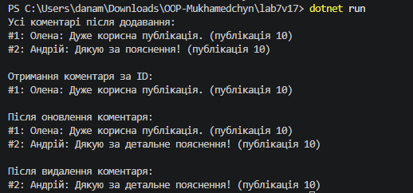

# Лабораторна робота №7

**Тема:** Узагальнені типи (Generics). `IRepository` з `where`-обмеженнями та тестами.  
**Мета:** Навчитися створювати узагальнені інтерфейси та класи, застосовувати `where`-обмеження для типів-параметрів і розробляти юніт-тести для перевірки узагальнених реалізацій (варіант 17: сутність `Comment`).

## Хід роботи

У ході виконання роботи за допомогою .NET CLI у директорії `OOP-Mukhamedchyn` було створено консольний проєкт `lab7v17` і тестовий проєкт `lab7v17.Tests` на базі xUnit.

У файлі `Program.cs` реалізовано:

* **Інтерфейс `IEntity`:** містить властивість `int Id { get; set; }`, спільну для сутностей репозиторію.
* **Узагальнений інтерфейс `IRepository<T>`:** оголошує методи `GetById`, `GetAll`, `Add`, `Update`, `Delete` та має обмеження `where T : IEntity`.
* **Узагальнений клас `InMemoryRepository<T>`:** реалізує CRUD-операції для об’єктів типу `T` у пам’яті за допомогою `List<T>`. Для неіснуючих ID генерується `KeyNotFoundException`, а для дубльованих ID під час додавання — `InvalidOperationException`.
* **Клас `Comment`:** реалізує `IEntity` та містить властивості `Id`, `Text`, `AuthorName` і `PostId`.

У методі `Main`:

1. Створено `InMemoryRepository<Comment>`.
2. Додано два коментарі та виведено всі елементи.
3. Продемонстровано отримання коментаря за ID.
4. Оновлено один коментар.
5. Видалено інший коментар і виведено актуальний стан репозиторію.

## Юніт-тести

У проєкті `lab7v17.Tests` створено тести для всіх методів `InMemoryRepository<Comment>`:

* `Add`: додавання нового елемента та перевірка дубльованого ID.
* `GetById`: отримання наявного елемента та поведінка для неіснуючого ID.
* `GetAll`: отримання всіх елементів.
* `Update`: оновлення наявного елемента та поведінка для неіснуючого ID.
* `Delete`: видалення наявного елемента та поведінка для неіснуючого ID.

## Результат виконання програми

## Відповіді на контрольні запитання

1. **Що таке узагальнені типи (Generics) і які переваги вони дають?**  
   Узагальнені типи дають змогу описати клас, інтерфейс або метод один раз і використовувати його з різними типами даних. Вони забезпечують перевірку типів під час компіляції, зменшують дублювання коду та не потребують небезпечних приведень типів. `IRepository<T>` і `InMemoryRepository<T>` можуть працювати з будь-якою сутністю, яка реалізує `IEntity`.

2. **Для чого використовується обмеження `where T : IEntity`?**  
   Воно дозволяє використовувати як параметр типу лише класи, що реалізують `IEntity`. Завдяки цьому репозиторій гарантовано може звертатися до властивості `Id` кожного елемента.

3. **Що таке шаблон `IRepository<T>` і навіщо він використовується?**  
   `IRepository<T>` — це абстракція доступу до даних. Вона визначає стандартні операції створення, читання, оновлення та видалення, не прив’язуючи код програми до конкретного способу зберігання. У цій роботі реалізація використовує пам’ять, але її можна замінити реалізацією для бази даних або файлу.

4. **Які переваги мають юніт-тести для узагальненої реалізації?**  
   Юніт-тести автоматично перевіряють кожну CRUD-операцію та помилкові сценарії. Це дає змогу швидко виявити регресії й підтвердити, що одна реалізація репозиторію коректно працює з обраною сутністю `Comment`.
